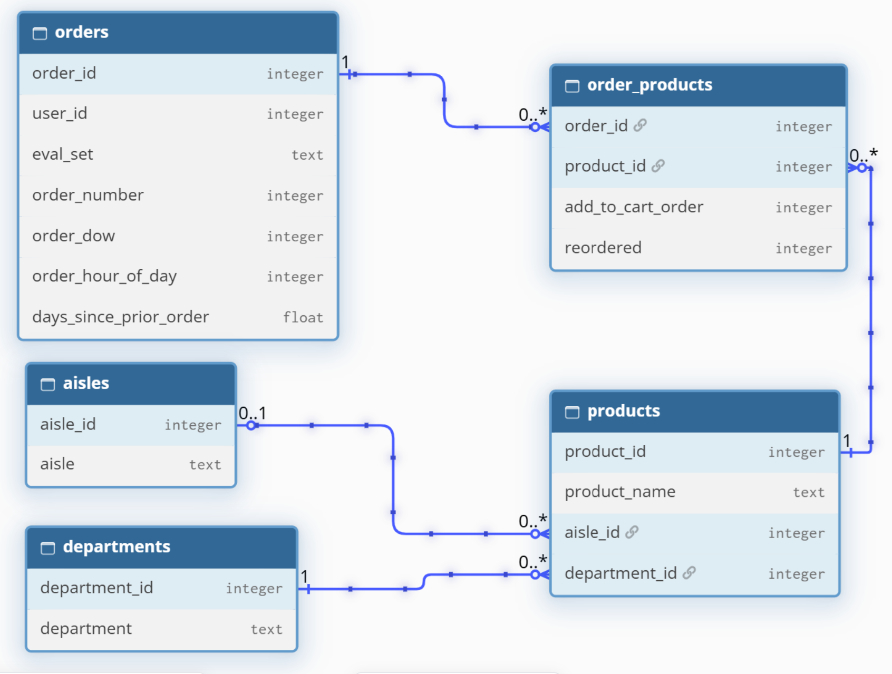

# Entity Relationship Diagram (ERD)

# Script
// This can be view from online dbdiagram.io
//

Table "aisles" {
  "aisle_id" integer
  "aisle" text
}

Table "departments" {
  "department_id" integer
  "department" text
}

Table "order_products" {
  "order_id" integer
  "product_id" integer
  "add_to_cart_order" integer
  "reordered" integer
}

Table "orders" {
  "order_id" integer
  "user_id" integer
  "eval_set" text
  "order_number" integer
  "order_dow" integer
  "order_hour_of_day" integer
  "days_since_prior_order" float
}

Table "products" {
  "product_id" integer
  "product_name" text
  "aisle_id" integer
  "department_id" integer
}

// Each order can have zero or many entries in order_products,
// while each row in order_products belongs to one specific order.
Ref: "orders"."order_id" <? "order_products"."order_id"

// A product can appear in zero or many order_products rows,
// while each row in order_products references one valid product.
Ref: "products"."product_id" <? "order_products"."product_id"

// An aisle can have 0 or many products, and a product can have 0 or 1 aisle
Ref: "aisles"."aisle_id" ?<? "products"."aisle_id"

// One department can have zero or many products,
// while each product belongs to one required department.
Ref: "departments"."department_id" <? "products"."department_id"

